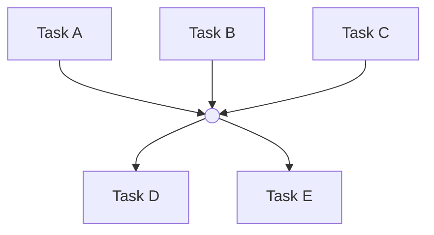

# Project Planning Skill

Create Linear project plans organized for the cella dev flow. The flow dispatches work by picking the next unblocked top-level issue (story) and iterating through its sub-issues sequentially.

## Planning Process

### 1. Understand the project

Before proposing stories, explore the codebase and ask clarifying questions. Understand:
- What exists today
- What the user wants to build
- Design and UX requirements
- Technical constraints

### 2. Define user stories

Each top-level issue is a **user story** — a shippable increment that can be validated independently. Stories should:
- Result in a working app state that can be deployed and tested
- Be ordered by dependency (use Linear's `blocks` relation)
- Have priority set to reflect execution order (1 = first)

Propose the story breakdown to the user before creating anything. Present it as a table with dependencies.

### 3. Create stories and sub-issues in Linear

Use the `linear` skill's `./linear.sh` for all API calls. Key details:

- **Project IDs**: The `slugId` from URLs is not the UUID. Always query `projects` first to get the real `id`.
- **Issues only have `description`** (no separate content field). Projects have both `description` (255 char limit) and `content` (unlimited markdown).
- **File mode for rich content**: When descriptions contain mermaid diagrams, code blocks, or other markdown that's hard to escape, use `./linear.sh --file`. Write the temp file using the `Write` tool, then call `./linear.sh` in a separate `Bash` call. This avoids permission issues (the `Bash(./linear.sh:*)` allow rule only matches when the command starts with `./linear.sh`).

```markdown
---
mutation: issue-update
id: ISSUE_UUID
---
Description with ```mermaid``` blocks, no escaping needed.
```

```
# Step 1: Use the Write tool to create /tmp/issue.md
# Step 2: Run in Bash:
./linear.sh --file /tmp/issue.md | jq .
```

- **Blocking relations**: `issueRelationCreate(input: { issueId: "BLOCKER", relatedIssueId: "BLOCKED", type: blocks })`
- **Relation types**: `blocks`, `duplicate`, `related`, `similar`

### 4. Add dependency diagrams

Every story with more than 2 sub-issues should include a mermaid dependency graph in its description. The project content should include the top-level story dependency graph plus links to each story.

#### Mermaid rules for clean rendering

- Use `graph TB` (top-to-bottom)
- **One edge per line** — never use `&` shorthand (`A --> B & C`), it causes side-entering edges
- **Use join nodes for fan-in/fan-out** — when N nodes all connect to M nodes, route through a join node `join((" "))` (renders as a small circle) to avoid N×M edge crossings:



- Quote node labels with `["label"]` to avoid parsing issues
- Include SEED identifiers in labels so they're clickable context

### 5. Write project overview

Set the project `content` field (not `description`) with:
1. One-paragraph summary of what the project achieves
2. Goals as bullet points
3. Story dependency mermaid graph
4. Links to each story issue
5. Tech stack summary

Set the project `description` to a one-line summary (max 255 chars).

## Sub-issue design

Sub-issues represent implementation tasks within a story. They should:
- Be small enough for a single focused implementation pass
- Have clear descriptions of what to build and where
- Use blocking relations to encode ordering within the story
- The dispatch flow processes them sequentially by index, but blocking relations document the dependency logic

## Reference

### Linear API fields

| Entity  | Short text         | Long markdown     |
|---------|--------------------|-------------------|
| Project | `description` (255 char limit) | `content` (unlimited) |
| Issue   | `description` (unlimited markdown) | — |

### Workflow states

Query with: `workflowStates(first: 50) { nodes { id name type team { key } } }`

Common types: `backlog`, `unstarted`, `started`, `completed`, `canceled`
